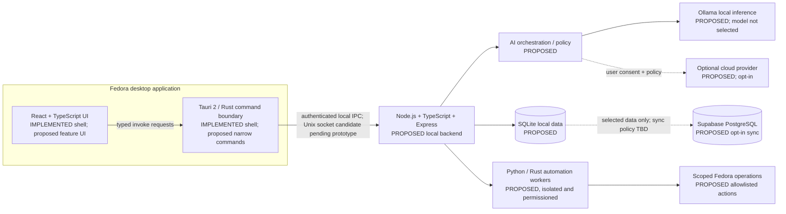

# NEXUS AI Desktop Architecture and Security Blueprint

**Vision:** “Intelligence in Motion.”

**Priority:** Fedora Linux desktop first. Android is postponed until the desktop application is complete, stable, and secure, and requires explicit approval before work resumes.

**Status key:** **IMPLEMENTED** describes repository evidence. **PROPOSED** describes a target design, not working software. **NOT IMPLEMENTED** identifies planned capabilities that are absent today.

## 1. Project Overview

NEXUS is intended to be a personal assistant for conversation, productivity, coding support, and user-approved computer actions. The assistant should adapt to the owner’s context while keeping the owner in control of private data and consequential actions.

Development is desktop-first. The Fedora laptop is the first complete product: its startup, authentication, privacy controls, local AI behavior, error handling, and release process must be validated before an Android companion is considered. Android is a future companion for selected, explicitly approved functions; it is not part of the current implementation plan.

**Core principles (DECIDED target; not yet implemented):**

- Local-first processing and storage when practical; cloud processing is optional, visible, and consent-based.
- Least privilege at every boundary. A model’s output is data, never authorization.
- Owner authentication before private memory or sensitive operations.
- Explicit approval for actions that change files, settings, accounts, or system state.
- Clear microphone, camera, network, and computer-control status.
- Minimize collection and retention; provide usable export and deletion controls.
- Keep the interface, application boundary, backend services, AI providers, and data stores separate.

**Current implementation:** a small Tauri 2 + React + TypeScript + Vite desktop shell with a visual focus toggle. It has no assistant service, login, AI, or persistence. The target stack decisions in this document are approved architecture direction, not evidence that those components or controls exist.

## 2. Proposed System Architecture

The diagram shows a target design. Solid boxes marked **IMPLEMENTED** are present in the repository; dashed boxes marked **PROPOSED** are not implemented.

### Component responsibilities and boundaries

| Component | Status | Responsibility and boundary |
|---|---|---|
| React + TypeScript | **IMPLEMENTED** shell; features **NOT IMPLEMENTED** | Render user-facing views and collect explicit user intent. It must not read arbitrary files, hold provider secrets, decide authorization, or execute model-proposed commands. |
| Tauri 2 + Rust | **IMPLEMENTED** native shell; app commands **NOT IMPLEMENTED** | The trusted application boundary: own the narrow native command surface, validate arguments and request context, enforce capability scopes, authenticate requests to the local backend, and mediate privileged local resources. A UI request is not itself authorization. |
| Node.js + TypeScript + Express | **NOT IMPLEMENTED** | Decided target local application service for routing, business logic, session policy, AI orchestration, persistence, and domain logic. It must authenticate callers and must not receive unrestricted operating-system authority. |
| Ollama | **NOT IMPLEMENTED** | Decided primary local inference provider, accessed through a backend adapter. No model is assumed to be installed or selected. |
| Cloud AI providers | **NOT IMPLEMENTED** | Optional provider adapters, disabled by default until the owner opts in. Send only the information necessary for the approved request. |
| SQLite / SQLCipher candidate | **NOT IMPLEMENTED** | Decided target for local persistence of conversations, preferences, and approved local memory. SQLite is not encrypted by default; SQLCipher is the preferred evaluation candidate, subject to driver/platform/license and key-lifecycle acceptance before sensitive data is stored. |
| Supabase PostgreSQL | **NOT IMPLEMENTED** | Optional future synchronization service. It remains disabled unless the owner explicitly consents to sync and selects data; biometric templates and local credentials are excluded by default. |
| Python/Rust automation | **NOT IMPLEMENTED** | Proposed isolated workers for specific integrations. Each worker receives only scoped inputs and permissions for one action family. |

### Trusted communication boundary

The intended request path is **React UI → Tauri/Rust security boundary → authenticated local Express backend → AI orchestration and authorized services**. React may submit a user intent through a narrow Tauri command. Rust validates the request shape, current session/access state, and operation scope before forwarding it. The backend authenticates the Rust-mediated caller, performs business logic and its own authorization checks, and calls only the provider or service allowed by policy. Privileged operations must be revalidated at execution time; frontend visibility or model output never grants authority.

The frontend must have no direct route to privileged OS resources or an API that bypasses Rust and backend policy. CORS, an obscure port, and binding to loopback are not authentication: other local processes may connect to a loopback listener, and origins do not establish caller identity. The backend must reject requests that cannot prove they came from the authorized NEXUS application/session. Rust must not forward caller-controlled privilege claims as trusted facts.

**Recommendation (candidate, not final decision):** prototype a Unix domain socket between the Rust boundary and Express backend. Place it in an owner-controlled directory with restrictive directory permissions (target `0700`) and socket permissions (target `0600`); verify ownership, permissions, stale-socket cleanup, and symlink/race behavior at startup. Permissions reduce access by other OS users but do not authenticate NEXUS against another process running as the same owner.

For each app launch, the trusted Rust boundary should generate a short-lived cryptographically random backend authentication token and retain its copy only in process memory. Deliver the backend's copy only over a private process-communication channel, such as a carefully designed inherited pipe or equivalent private channel; never put it in frontend storage, command-line arguments, ordinary environment variables, URLs, or logs. Bind its validity to that launch, rotate it whenever the backend restarts, and invalidate the old token and outstanding sessions. Validate schemas, request size, method, scope, and launch identity; use one-time nonces or a strictly checked sequence/challenge mechanism to reject replay, and fail closed on missing, stale, malformed, or repeated credentials. Exact token handoff, proof format, and replay protocol require a security-reviewed prototype.

**Peer-credential research gate:** Node.js documents Unix-domain sockets in `net`, but its documented `net.Socket` API does not expose a peer UID/PID credential method. Do not assume Express can directly verify Linux peer credentials. Prototype whether a maintained Node/native interface can safely obtain and validate Linux credentials (for example kernel `SO_PEERCRED`) for each accepted socket. If it cannot, evaluate a small Rust broker that owns the socket, checks peer credentials and request policy, and forwards only authenticated requests to the backend over a private channel. A random token alone does not establish OS peer identity if another same-user process can obtain it. Select transport/auth only after prototype, threat review, and negative tests. A compromised user account can still act with that account's privileges; root can bypass local controls.

## 3. Frontend Architecture

The current `App.tsx` is a single shell component with local focus state (**IMPLEMENTED**). The following UI areas are **PROPOSED** and should be introduced as separate feature components rather than as one growing screen:

- **Chat interface:** conversation list, composer, response rendering, cancellation, and clear model/provider status.
- **Reactive AI core:** frontend state coordinating request lifecycle and streamed response display. It is a presentation/controller layer, not the security policy engine.
- **Voice interface:** push-to-talk or an explicitly enabled listening mode, transcript review, visible microphone state, and cancellation. Raw audio retention is off by default.
- **Settings:** local model/provider choice, privacy, language, accessibility, and retention options.
- **Memory management:** review, edit, export, and delete remembered facts; show sources and retention.
- **Security dashboard:** owner session, access level, devices/authenticators, recent security actions, and lock/recovery controls.
- **Notifications:** user-approved reminders and integration events with per-source controls.

Frontend features call a typed application API through the Tauri/Rust boundary, which forwards only authenticated, validated requests to the Express backend. The frontend sends an intent and receives a result; it does not gain filesystem, keyring, microphone, camera, shell, or database privileges by importing a UI package. The Rust command layer and backend independently validate scope and authorization. This remains a target design and is **NOT IMPLEMENTED**.

## 4. Backend Architecture

All services below are **PROPOSED**. No API endpoint or backend implementation currently exists.

### Service boundaries

- **API routing:** versioned request parsing, input validation, response serialization, and request IDs.
- **AI orchestration:** construct provider-neutral requests, retrieve permitted context, call a configured provider, and stream/cancel results.
- **Model management:** report provider/model availability and expose an allowlisted model catalog; never assume an installed model is safe or available.
- **Authentication and authorization:** establish owner sessions, evaluate access level, enforce operation policy, and expire/revoke sessions.
- **Memory management:** store only user-approved facts, filter by owner/session, and support inspect/update/delete/export.
- **File operations:** use an explicit user-selected or configured scope; canonicalize paths and reject traversal or symlink escapes.
- **Computer control:** validate a typed action against a policy and request confirmation before consequential effects. The model does not execute shell strings.
- **Notifications:** queue/display only user-enabled notification types and avoid exposing private content on locked screens.
- **Logging and diagnostics:** record security-relevant metadata and outcomes while excluding credentials, raw biometrics, and unnecessary prompt/transcript contents.

### Proposed API conventions

The following are examples of **PROPOSED endpoints only**, not existing endpoints:

| Proposed endpoint | Purpose |
|---|---|
| `GET /api/v1/health` | **PROPOSED; NOT IMPLEMENTED.** In `LOCKED`, return only the generic value `available` or `unavailable`. Do not expose component-specific readiness, provider/Ollama status, dependency details, internal diagnostics, personal data, or private-activity information. In `VERIFIED OWNER`, more detailed operational health may be considered only with authorization, data minimization, and applicable security reviews; this is not an implemented capability. |
| `GET /api/v1/session` | Return current session/access level or a locked/unauthenticated state. |
| `POST /api/v1/auth/challenges` | Begin an approved owner-authentication ceremony. |
| `POST /api/v1/chat/turns` | Submit an owner-authorized turn; support cancellation and provider status. |
| `GET /api/v1/models` | Return configured, available model choices and resource requirements. |
| `POST /api/v1/actions/{action}/preview` | Validate and describe a proposed action without performing it. |
| `POST /api/v1/actions/{action}/confirm` | Execute a previously reviewed action after fresh authorization and confirmation. |

Use a consistent JSON envelope, explicit API versioning, bounded request sizes, schema validation, request IDs, and idempotency keys for retryable writes. Every request must authenticate the application/session independently of loopback binding and then undergo operation-level authorization. Reject missing, expired, replayed, or improperly scoped credentials. Errors should have stable machine-readable codes plus safe user-facing messages. Do not return stack traces, filesystem paths, tokens, or provider secrets to the UI. Logs should carry correlation IDs without copying private request bodies. These controls are proposed acceptance targets, not existing API behavior.

## 5. NEXUS Identity and Security Architecture

The owner-authentication system is **PROPOSED / NOT IMPLEMENTED**. The approved primary NEXUS authentication direction is a strong passphrase. Fedora authentication may provide additional verification but is not sufficient alone. Owner enrollment requires an already authenticated Fedora user session, the approved primary authenticator, and explicit informed consent. A logged-in session alone does not silently enroll an owner. Enrollment must establish that the person setting up NEXUS is the intended owner; implementation details and recovery remain open decisions.

### Face recognition

1. **Enrollment:** only within the authenticated Fedora user session, explain purpose and retention, obtain explicit consent, and capture a short, quality-checked enrollment locally. Require the approved strong-passphrase primary authentication method in the enrollment ceremony. Do not silently enroll from ordinary camera use or let an unauthenticated person claim owner status.
2. **Verification:** perform a fresh comparison for the transaction/session policy. Apply rate limits, lockouts or increasing delays, and an alternate authenticator.
3. **Liveness / presentation attack detection:** evaluate resistance to printed photos, screen replays, masks, camera substitution, and synthetic video. Test varied lighting, pose, and demographic performance. Ordinary laptop webcams may lack trusted depth/IR sensors and can be substituted or compromised; software liveness can be bypassed and has false accepts/rejects. Liveness is a mitigation, not proof by itself.
4. **Local processing:** prefer local capture and matching. Minimize sample lifetime; do not retain raw face video by default. Protect any derived template as sensitive data, with deletion/re-enrollment procedures.
5. **Technology choice:** model, sensor trust, thresholds, and independent evaluation are undecided. No face model is installed or integrated today.

### Voice biometrics

Speech-to-text (recognizing words) is distinct from speaker recognition (estimating speaker identity). Voice recognition may be considered for personalization, but it must never independently authorize sensitive actions or serve as standalone account authentication. Voice can be replayed, synthesized, or imitated; challenge-response and spoof detection do not make it foolproof. Keep processing local where feasible, minimize capture/retention, and provide non-voice alternatives. NEXUS does not currently implement desktop speech-to-text or speaker recognition. The cited NIST guidance does not support treating voice comparison as a standalone authenticator.

### Passphrase, optional additional verification, and recovery

- **Primary authentication:** a strong passphrase is the approved primary NEXUS authentication direction. Its verifier, enrollment ceremony, and safeguards remain unimplemented and require evaluation.
- **Passkeys/FIDO2:** passkeys and FIDO2 are not approved as primary authentication methods. Any optional additional use requires separate owner approval. If approved for evaluation, test WebAuthn origin/RP ID behavior for Tauri's Linux custom origin and actual authenticator APIs; do not assume browser support implies that a Tauri custom origin works. Do not claim native Linux platform-authenticator support until tested on the target Fedora/Tauri combination.
- **Fedora account reauthentication:** may provide additional verification but is not sufficient alone. Evaluate it only as a supplementary method if selected, subject to a supported and reviewable Fedora integration. An already active desktop session alone is not evidence of fresh reauthentication.
- **PIN policy:** a short numeric PIN is not approved as standalone authentication.
- **Passphrase verifier candidate:** Argon2id remains an unapproved technical candidate. If evaluated, use unique random salts and versioned parameters. RFC 9106's constrained-memory recommendation (Argon2id, 3 passes, 4 lanes, 64 MiB, 128-bit salt, 256-bit tag) is only a starting benchmark; measure user-facing latency/resource use and review parameters before approval. Persist attempt counters and lockout state securely. If an attacker extracts a local verifier, offline guessing bypasses online throttling; a weak or reused passphrase remains vulnerable, and hashing does not make a low-entropy secret strong.
- **Recovery:** recovery must follow O-01 and must never bypass LOCKED restrictions. Define a local, owner-controlled flow that does not accept face or voice alone; Fedora reauthentication may provide additional verification but cannot independently unlock NEXUS. Recovery details remain open and require owner approval; recovery should revoke old sessions/keys and create an audit event.
- **Emergency lock:** immediately revoke the current app session, hide protected content, cancel in-flight actions, and require full re-authentication to resume.

Biometrics are probabilistic, can be captured without consent, and can be spoofed. Face is an additional identity signal and must never independently authenticate the owner. Voice biometrics must never independently authenticate the owner or authorize actions. The strong passphrase is the approved primary direction. Passkeys/FIDO2 are not approved as primary methods; any optional additional use requires separate owner approval. Verifier details, optional additional methods, and OS key-storage choices remain **OPEN**. Biometric template and demographic performance need careful evaluation.

## 6. Access Control Levels

These levels are **PROPOSED** policy states. “Verified Owner” is not a claim that biometrics alone verified identity.

| Level | Permitted | Restricted |
|---|---|---|
| **LOCKED** | Show non-sensitive shell/status, accept authentication, allow emergency lock/recovery controls. | No private conversations or memory, provider credentials, file contents, automation, or notifications that disclose private content. |
| **VERIFIED OWNER** | Use ordinary assistant features and owner-approved memory/provider settings; preview low-risk actions. | No action outside configured scopes; sensitive, destructive, or externally visible actions require elevation and confirmation. |
| **ELEVATED AUTHORIZATION** | Perform one specifically approved sensitive operation or short, purpose-bound group of operations. | No blanket elevation. Require fresh step-up verification, show exact target/effect, expire quickly, and log result. |

Authorization is checked at the point of use in a trusted backend/Rust boundary, not inferred from UI visibility, model output, or a stale frontend flag.

### Fedora session lock, suspend, and keyring lifecycle

NEXUS must observe Fedora user-session lock and system suspend/resume events through a reviewed desktop/session integration (the event API is **OPEN**). On lock or suspend it must immediately hide protected UI, revoke or suspend sensitive access, cancel or safely pause pending privileged work, and suppress private lock-screen notifications. On unlock, ordinary access follows the approved session policy; any elevated authorization must be discarded and obtained again before a sensitive operation. Do not restore an elevated grant merely because the process survived suspend.

**Preferred Fedora integration candidate (not implemented or finalized):** Secret Service API through `libsecret`, using GNOME Keyring when it is the available session provider. At startup and before each secret-dependent operation, check that the D-Bus service and target collection are available and usable; handle locked collections, prompts, service disappearance, and lock/unlock races. Never fall back to plaintext files, SQLite, environment variables, or frontend storage. Use minimal non-sensitive lookup attributes because Secret Service lookup attributes may not be confidential. The Secret Service API does not guarantee application-specific isolation of a secret once the user's collection is unlocked; another process with access to that session service may be able to request it. An unlocked OS keyring is not proof of an authenticated NEXUS owner session. Test behavior for startup before unlock, lock during use, reset, and loss before finalizing this integration.

These controls cannot fully protect NEXUS from a compromised Fedora account running as the owner, malware with equivalent user privileges, or root-level compromise. Root can inspect or alter processes, files, and local policy; this architecture reduces accidental and lower-privilege exposure but does not promise protection from a compromised operating system.

## 7. Permission-Based Computer Control

Computer control is **NOT IMPLEMENTED**. It must be opt-in and deny by default.

- Allow only documented operation families, such as opening a named application or manipulating a user-selected file through a bounded API.
- Require explicit file/folder selection or configured scopes. Resolve canonical paths and deny paths outside the granted scope.
- Do not execute arbitrary terminal commands or shell text from model output. If a narrow command is eventually required, map a typed action to a fixed executable and validated arguments; run with least privilege and a constrained environment.
- Preview target, arguments, data sent, and expected effect. Require fresh user confirmation for delete/overwrite, installation, external sharing, account/security changes, or system configuration.
- Keep an audit entry with actor/session, policy decision, action ID, target class, confirmation, result, and time; avoid recording file contents or secrets.
- Support cancel before execution, bounded timeouts, safe rollback/compensation where possible, and clear recovery instructions. Never promise rollback for irreversible external actions.

NEXUS must not have unrestricted filesystem, shell, or operating-system access by default. Tauri capabilities and command scopes should expose only the specific native operations required; capability configuration reduces exposure but does not replace correct Rust-side authorization and scope checks.

## 8. Privacy and Data Protection

All items here are **PROPOSED** until implemented and reviewed.

- Keep inference, transcripts, memory, and settings local by default when the selected service supports it. Before cloud use, show provider, data categories, purpose, and an opt-in control; allow cloud use to be disabled.
- Do not record raw face/voice samples unless a separately approved flow requires temporary capture. Erase working samples after the transaction and expose retention/deletion controls.
- Keep passkey private keys and service credentials out of frontend state, source files, logs, SQLite plaintext fields, and sync payloads. Preferred Fedora integration candidate is Secret Service through `libsecret`/GNOME Keyring, subject to compatibility and security testing.
- For the candidate Secret Service integration, perform runtime availability checks, handle locked/unavailable collections and lock/unlock races, fail closed, use minimal non-sensitive lookup attributes, and never use plaintext fallback. Do not treat an unlocked keyring as proof of an authenticated NEXUS owner session; Secret Service does not guarantee app-specific isolation for secrets available from an unlocked collection.
- **SQLite encryption candidate:** SQLCipher is preferred for evaluation, but is not yet implemented or finalized. First confirm compatibility with the selected Node.js SQLite driver and Express runtime, Fedora packaging and native build/distribution, and all applicable licenses/attribution requirements. Generate a random database key with a cryptographically secure generator and store it only through the selected OS credential facility. Test key rotation, encrypted backups, restore/recovery, secure deletion, and migration of any existing database. No sensitive database persistence is allowed until these acceptance checks pass.
- Use authenticated TLS for cloud communications; use an authenticated, origin-restricted local channel for any loopback service. Avoid unauthenticated wildcard CORS or listening on all interfaces.
- Gate memory reads by owner/session and purpose. Make memory inspectable, editable, exportable, and deletable; separate explicit user facts from model-generated inferences.
- Keep local processing and storage as the default. Any cloud inference or Supabase synchronization requires explicit, informed consent for the relevant data and purpose; do not silently fail over or sync.
- Provide visible microphone/camera/network indicators, explicit consent before capture, and controls to stop capture immediately.
- Never sync biometrics, authentication secrets, or raw recordings by default. Make each synchronized category opt-in and explain its retention and deletion behavior.

## 9. AI Architecture

AI integrations are **NOT IMPLEMENTED**. Do not assume Ollama or any model is installed or running.

1. The backend receives an authenticated user turn, checks access and consent, and constructs a provider-neutral request.
2. It gathers only context the user/session can access, marks external content untrusted, and redacts secrets where practical.
3. A provider adapter checks availability and resource limits, then invokes local Ollama by default when enabled. Cloud adapters are optional and require per-setting/user consent.
4. The backend streams or returns the response, validates structured output, and treats all model output as untrusted.
5. Any requested tool action is separately authorized, previewed, and confirmed by policy; prompt instructions cannot grant a capability.
6. The UI presents provider/model status, cancellation, and a clear error or offline state. Persist only according to the owner’s retention settings.

Model selection should consider language quality, license, RAM/VRAM, disk space, latency, and supported context length on the actual laptop. Provide a small default profile and user-controlled model choices only after testing; avoid loading multiple large models simultaneously. Offline mode should clearly identify unavailable cloud-only features instead of silently sending data elsewhere.

## 10. Data Architecture

All schemas and migrations are **NOT IMPLEMENTED** and must not be inferred from this proposal.

| Store | Proposed responsibility | Sync policy |
|---|---|---|
| SQLite / SQLCipher candidate | Local settings, conversation metadata/content according to retention, approved memory items, provider configuration references, and local audit metadata. | Local by default. SQLite alone is unencrypted. SQLCipher is the preferred encryption candidate pending Node driver/Fedora native packaging, license, random key, keyring, rotation, backup, recovery, deletion, and migration tests. No sensitive persistence until acceptance criteria pass. |
| Supabase PostgreSQL | Optional future account-level synchronization, backup, or cross-device data explicitly selected by the owner. | Off by default; sync only allowlisted categories with consent and deletion semantics. |
| Memory service | Normalize owner-approved facts with source, timestamp, confidence/provenance, and deletion link. | Store locally first; never silently promote a model inference to fact. |
| Authentication records | Public credential identifiers, enrollment state, verifier metadata, lockout state, and revocation records. | Keep local. Do not sync private key material, PINs, biometric samples, or templates. Store any protected secret in Fedora's appropriate OS keyring, not plaintext configuration. |
| Settings | Theme, language, model/provider choice, privacy and retention settings, scoped permissions. | Decide field-by-field; secrets are references to protected credential storage. |
| Audit logs | Security decisions, approvals, action IDs/results, and session lifecycle. | Local and retention-limited initially; sync policy requires separate approval. |

Define migrations, backup, restore, deletion, and encryption-key recovery only after the local storage and synchronization decisions are approved. Supabase remains optional and each synchronization category requires explicit user consent. Sensitive content must not be written to SQLite before its encryption/key-lifecycle design is approved and tested.

## 11. Error Handling and Reliability

- **Backend failure:** surface service state, retry only idempotent operations with bounded backoff, and let the UI recover/reconnect. Do not show stale data as current without marking it.
- **AI provider failure:** distinguish offline, unavailable model, timeout, rate limit, malformed response, and provider refusal. Do not silently switch to a cloud provider.
- **Startup failure:** provide a recoverable screen/log ID rather than a panic-only path; preserve non-sensitive diagnostics and offer retry.
- **Authentication failure:** use generic user-facing messages, rate limiting, lockout policy, recovery guidance, and audit outcomes without storing biometric samples.
- **Fedora lock/suspend or keyring failure:** lock protected content and invalidate elevated grants on lock/suspend. If the OS keyring is locked/unavailable, deny actions requiring its secrets, do not use plaintext fallback, and explain the recovery path. Event integration and keyring-loss behavior require implementation and validation.
- **Availability checks:** distinguish process health from readiness of SQLite, Ollama, cloud, and automation integrations. Health responses expose no secrets or private records.
- **Logging:** structured, bounded, access-controlled. Exclude credentials, keys, PINs, raw audio/video, full prompts/responses, and private file contents by default. Add redaction tests before telemetry or export features.
- **Cancellation:** propagate cancellation through UI, backend, provider, and worker. If a side effect may already have occurred, report its state instead of claiming cancellation succeeded.

## 12. Development Phases

Each phase depends on the previous foundations; Android remains gated on Phase 9 and explicit approval.

| Phase | Objectives | Dependencies | Completion criteria |
|---|---|---|---|
| **1 — Architecture and security foundation** | Approve component boundaries, threat model, local/cloud policy, trust boundaries, data classification, enrollment trust prerequisite, and open decisions. | None. | Signed-off decisions identify each trust boundary and unresolved item; threat model covers every listed threat; no unresolved decision is silently encoded in implementation. **Not yet met.** |
| **2 — Desktop backend foundation** | Add Express/TypeScript service, validated config, versioned health route, centralized errors, request IDs, and authenticated local IPC. Prototype the Unix-socket candidate and peer authentication. | Phase 1 transport, peer-authentication, and runtime choices. | Service starts/stops reliably; socket directory/socket permissions are verified; no token is exposed to frontend/argv/ordinary environment/logs; token rotates on backend restart; malformed, unauthorized, replayed, and stale requests fail closed; Node peer-credential limitations are resolved or a reviewed Rust broker is used; direct frontend calls cannot invoke privileged operations. **Not yet met.** |
| **3 — Owner authentication and access control** | Implement approved owner enrollment, session lifecycle, LOCKED/VERIFIED/ELEVATED policy, recovery, Fedora lock/suspend response, and audit events. | Phases 1–2; approved strong-passphrase-primary direction, passphrase verifier evaluation, O-01 recovery requirements, and key-storage decisions. Fedora reauthentication is conditional supplementary verification; passkeys/FIDO2 are not approved as primary methods and any optional additional use requires separate owner approval. | Tests demonstrate an unauthenticated Fedora user cannot enroll as owner; enrollment requires the approved primary authentication method, fresh Fedora reauthentication only if selected as additional verification, and explicit consent; face alone and voice alone cannot authenticate the owner; no short numeric PIN is accepted as standalone authentication; persistent throttling and passphrase verifier resistance are tested for the passphrase-primary method; recovery follows O-01 and cannot bypass LOCKED restrictions; session revocation works; protected UI locks on Fedora lock/suspend; elevated operations require fresh reauthentication after unlock. **Not yet met.** |
| **4 — AI integration and conversations** | Add Ollama adapter, explicit model configuration, chat flow, streaming/cancel, offline status, optional cloud abstraction. | Phases 2–3; consent and provider secret policy. | Local-only flow works without cloud; cloud processing is off until explicit consent; provider failures are safe; prompt-injected content and model output cannot bypass authorization or directly execute tools. **Not yet met.** |
| **5 — Voice assistant and personal memory** | Add consent-based audio interface, speech recognition, memory review/edit/delete, retention. Speaker recognition, if explored, is limited to personalization and never authorization. | Phases 3–4; device capability and biometric decisions. | Capture indicators and cancellation work; STT is tested separately from speaker recognition; speaker match cannot authorize sensitive actions; memory provenance/deletion are verified; raw biometrics and recordings are not retained by default. **Not yet met.** |
| **6 — Desktop automation and computer control** | Add narrowly scoped actions, previews, step-up checks, confirmations, isolation, cancellation, and audit records. | Phases 1–5; sandbox and permission model. | Allowlist and negative tests prove denied actions cannot escape scopes; traversal and out-of-scope file requests are rejected; no unrestricted shell endpoint exists; AI-generated commands are treated as untrusted data; sensitive actions require explicit approval and recovery behavior is demonstrated. **Not yet met.** |
| **7 — Productivity, notifications, and integrations** | Add approved calendar/files/notifications/integration adapters with per-source permissions. | Phases 3–6. | Each integration has consent, scope, revocation, failure handling, and audit coverage; private lock-screen notification content is suppressed; any cloud or sync data categories require explicit consent. **Not yet met.** |
| **8 — Security audits, testing, and performance optimization** | Threat-model review, dependency review, security tests, privacy checks, resource profiling, accessibility. | Phases 1–7. | Tests confirm secrets are absent from plaintext configuration/logs; SQLCipher driver compatibility, Fedora native packaging, license/attribution, random key handling, rotation, backup/restore, recovery, deletion, and migration all pass; Secret Service lock/unavailability/races fail closed; audit events omit unnecessary private content; unauthorized local requests are rejected; high-risk findings are resolved or explicitly accepted; supported laptop resource envelope documented. **Not yet met.** |
| **9 — Final desktop validation** | Validate packaging, upgrades, recovery, offline mode, supported Fedora hardware, session lock/suspend/unlock, usability, and release checklist. | Phases 1–8. | Release candidate passes acceptance and security criteria, including lock on Fedora lock/suspend, fresh elevation after unlock, and offline/local-only behavior; support/rollback plan exists. Android remains postponed until this validation is complete and separately approved. **Not yet met.** |
| **10 — Android companion** | Define a limited companion feature set and shared identity/sync boundaries. | Phase 9 complete and explicit approval. | Separate approval, mobile threat review, and acceptance criteria before Android implementation begins. |

## 13. Technical Decisions and Open Questions

The following choices require owner approval before implementation:

1. Is Express a separate local process or an embedded child process? Unix domain sockets are the preferred transport candidate. Which private token handoff and replay-resistance protocol is safe, and can the selected Node runtime obtain Linux peer credentials for accepted sockets? If not, should a Rust broker own the socket? Prototype and security testing are required before final selection.
2. If separately approved as an optional additional method, which passkey/WebAuthn authenticator and relying-party identity work with the actual Tauri Linux custom origin and Fedora WebKit runtime? Evaluate external FIDO2 keys, native FIDO2 integration, or external-browser authentication only within that approved scope. Fedora account reauthentication may provide supplementary verification but is not sufficient alone. Do not assume Linux platform authenticator support.
3. The strong passphrase is the approved primary NEXUS authentication direction. What verifier design, persistent-throttle protection, Argon2id evaluation parameters (if that candidate is considered), OS-keyring dependency, offline-verifier risk disposition, and recovery ceremony should be approved? Argon2id remains unapproved pending evaluation; recovery must follow O-01 and cannot bypass LOCKED restrictions.
4. Should face recognition be included on laptop hardware at all? Which camera/sensor, local model, liveness/PAD evaluation, demographic testing, template protection, and deletion design are acceptable, given webcam and software liveness limitations?
5. Voice recognition is not an authorization method; if used for personalization, what replay/synthetic-audio tests, processing and retention limits are required?
6. Can Secret Service through libsecret/GNOME Keyring meet runtime availability, lock/unlock race, failure, lookup-attribute, and lifecycle requirements on supported Fedora sessions? How should NEXUS handle a locked/reset/unavailable collection, acknowledging that unlocked secrets are not guaranteed app-isolated?
7. Does SQLCipher work reliably with the selected Node.js SQLite driver and Fedora packaging/native build? Which licensing/attribution path and database key lifecycle (random creation, OS-keyring storage, rotation, recovery, backups, deletion, migration) will be accepted before sensitive persistence?
8. Supabase is optional and requires explicit consent. Is sync desired at all? Which fields may sync, in which regions, under what account authentication, retention, export, and deletion policy?
9. Which Ollama models can the laptop run acceptably? Which resource caps, model licenses, and quantization profiles are acceptable?
10. Which optional cloud providers, if any, may receive user data? What data categories require an additional explicit consent prompt?
11. Which computer-control actions are in scope, and what OS-level sandbox (for example, separate unprivileged worker, restricted filesystem, and fixed executable allowlist) is required?
12. Which Fedora session lock/suspend event integration is supported, and what should happen if events are missed or the process resumes unexpectedly?
13. Which logging retention, security dashboard visibility, and notification lock-screen disclosure rules should apply?

## 14. Security Threat Model

Threats and controls below are **PROPOSED**. Controls reduce risk; they do not guarantee prevention.

| Threat | Possible impact | Proposed mitigations |
|---|---|---|
| Unauthorized physical access | Private conversations, memory, credentials, or actions may be exposed. | **Mitigation:** LOCKED state, approved strong-passphrase primary authentication, any separately approved additional verification, short session policy, emergency lock, no sensitive lock-screen content, and fresh approval for sensitive actions. **Limit:** an already unlocked or stolen authenticated OS session may expose data until lock detection or reauthentication takes effect. |
| Malicious owner-enrollment attempt | An attacker claims the owner account and enrolls their own authenticator/biometrics. | **Mitigation:** require an already authenticated Fedora user session, the approved strong-passphrase primary authentication method, explicit consent, and an auditable enrollment ceremony; do not permit silent enrollment or face/voice-only enrollment. **Limit:** malware or an attacker controlling the legitimate user session may still interfere; initial device ownership/recovery ceremony needs design and testing. |
| Face spoofing, webcam substitution, or liveness bypass | False identity signal or enrollment takeover. | **Mitigation:** face is only an additional signal, never sole authentication; test PAD against prints, screens, masks, synthetic video and camera substitution; use rate limits and alternate strong authentication; minimize templates/samples. **Limit:** ordinary webcams lack trusted sensing guarantees, software liveness can be bypassed, and false accepts/rejects remain possible. |
| Voice replay, synthesis, imitation, or malicious spoken input | Personalization confusion, privacy exposure, or unsafe requested action. | **Mitigation:** voice matching cannot independently authorize sensitive actions; distinguish STT from speaker recognition; treat transcripts as untrusted input; use explicit confirmation and strong authentication for sensitive operations; minimize raw audio retention. **Limit:** replay/synthetic detection is imperfect and speech recognition can mis-transcribe. |
| Compromised Fedora user session | Malware or another process running as the user reads data, invokes local services, or manipulates NEXUS. | **Mitigation:** app/session authentication, narrow privileges, keyring-protected secrets, short-lived grants, lock/suspend response, and audit events. **Limit:** equal-privilege malware can often act as the owner and may inspect user-readable data; NEXUS cannot fully secure a compromised account. |
| Root-level or OS compromise | Attacker can alter binaries, inspect processes/data, bypass local policy, or capture credentials. | **Mitigation:** minimize privileges, use OS security facilities, verify updates, and make compromise detectable where feasible. **Limit:** root can bypass application controls; NEXUS does not promise protection from root or a compromised OS. |
| Local API abuse by another process | Unauthorized process calls Express endpoints, steals service data, or requests actions. | **Mitigation:** loopback binding is not sufficient; authenticate the local peer/app session, scope and expire credentials, reject replay/unauthorized requests, restrict interfaces/origins, and repeat authorization in Rust and backend. Test negative cases. **Limit:** transport/authentication scheme is unresolved; same-user compromise may steal or exercise credentials. |
| Direct or indirect prompt injection | Untrusted documents, web content, or prompts cause disclosure or unsafe proposed actions. | **Mitigation:** label external input untrusted, minimize context, enforce server-side authorization and typed tools, separate data from policy, preview and confirm consequential actions. **Limit:** model behavior is probabilistic; prompt filters cannot guarantee detection, so authorization must not rely on model compliance. |
| Malicious AI-generated commands or actions | Destructive, exfiltrating, or unauthorized effects. | **Mitigation:** treat generated commands as untrusted data; no unrestricted shell execution; allowlisted typed actions, least privilege, action preview, explicit confirmation, cancellation, and audit. **Limit:** approved actions can still have unintended effects; rollback may be impossible. |
| File traversal or unauthorized file access | NEXUS reads, modifies, or deletes data outside user-authorized scope. | **Mitigation:** explicit user-selected roots, canonical path and symlink checks at execution, scoped worker, deny by default, no frontend direct filesystem access, and adversarial tests. **Limit:** filesystem races and OS-level compromise remain possible; implementation must handle links/races safely. |
| Privilege escalation through Tauri/backend/automation | Compromised frontend or service reaches native/system APIs with excessive rights. | **Mitigation:** narrow Tauri capabilities, Rust-side validation and authorization, backend checks, isolated unprivileged workers, fixed executable allowlist, and no generic shell. **Limit:** bugs in trusted Rust/backend code or misconfigured capabilities can still expose authority. |
| Credential theft or keyring unavailable | Cloud accounts, owner sessions, or protected local data are compromised or become inaccessible. | **Mitigation:** evaluate Fedora Secret Service storage, no plaintext config/frontend/log storage, expiration/revocation, and fail-closed behavior when keyring is locked. **Limit:** Secret Service does not guarantee app-specific isolation; user/root malware may access secrets while the keyring is unlocked; key loss may make encrypted data unrecoverable. |
| SQLite data theft or loss | Conversations/memory are disclosed, altered, or unrecoverable. | **Mitigation:** evaluate SQLCipher and verify encryption/key lifecycle before sensitive storage, minimize retention, protect random keys via OS facilities, and define encrypted backups/deletion. **Limit:** SQLite is unencrypted by default; SQLCipher is not implemented or accepted and recovery can fail if keys are lost or OS is compromised. |
| Dependency or update compromise | Malicious package, plugin, build, or update gains application/backend privileges. | **Mitigation:** minimize dependencies/plugins, review and pin versions, monitor advisories, verify release artifacts, protect signing/update pipeline, and provide rollback. **Limit:** supply-chain controls reduce risk but cannot prove every dependency or build system benign. |
| Cloud provider compromise or misuse | Cloud data is disclosed, retained, altered, or unavailable. | **Mitigation:** cloud is optional and off absent explicit consent, disclose data categories, send minimum necessary data, use authenticated TLS, support revocation/deletion, and never silently fail over from local AI. **Limit:** once data is transmitted, provider-side compromise, retention, jurisdiction, or deletion cannot be fully controlled by NEXUS. |
| Malicious third-party integration | Data exfiltration or unauthorized external effects through an integration. | **Mitigation:** per-integration scopes and consent, isolated adapters, bounded data access, revocation, audit, and integration-specific threat review. **Limit:** an authorized integration can still be compromised or misuse data within its granted scope. |

### Security and research references

- Tauri 2 capabilities and permission scopes: [Capabilities](https://v2.tauri.app/security/capabilities/) and [Permissions](https://v2.tauri.app/security/permissions/).
- Tauri Content Security Policy: [CSP documentation](https://v2.tauri.app/security/csp/).
- Tauri Linux custom-origin behavior: [Tauri application source/API documentation](https://docs.rs/tauri/latest/src/tauri/app.rs.html) describes custom-protocol origins by platform; this does not establish WebAuthn compatibility, which must be tested in the target webview.
- Biometrics and authenticator guidance: [NIST SP 800-63B-4](https://pages.nist.gov/800-63-4/sp800-63b.html).
- Passkey/WebAuthn model: [W3C Web Authentication Level 3](https://www.w3.org/TR/webauthn-3/).
- Node.js IPC API surface: [Node.js `net` documentation](https://nodejs.org/api/net.html) documents Unix-domain socket support; peer-credential access is not documented on its `net.Socket` API and must not be assumed.
- Linux Unix-domain peer credentials: [Linux `unix(7)` manual](https://man7.org/linux/man-pages/man7/unix.7.html) documents kernel peer-credential mechanisms such as `SO_PEERCRED`; integration through the selected Node runtime remains to be proven.
- External FIDO2 evaluation: [Yubico libfido2 documentation](https://developers.yubico.com/libfido2/) documents Linux support and communication with USB/NFC FIDO devices; NEXUS integration remains undecided.
- Passphrase verifier benchmark: [RFC 9106, Argon2](https://www.rfc-editor.org/rfc/rfc9106.html), including its memory-constrained Argon2id recommendation; this is a benchmark starting point, not NEXUS's approved parameters.
- SQLCipher encryption and packaging: [SQLCipher for Linux Community Edition](https://www.zetetic.net/sqlcipher/sqlcipher-linux-community/), [SQLCipher design](https://www.zetetic.net/sqlcipher/design/), and [SQLCipher license options](https://www.zetetic.net/sqlcipher/license/). Driver compatibility, Fedora packaging, and license/attribution still require project-specific verification.
- Fedora keyring candidate: [Freedesktop Secret Service API](https://specifications.freedesktop.org/secret-service/latest/) and [GNOME libsecret documentation](https://gnome.pages.gitlab.gnome.org/libsecret/). Lookup attributes are metadata rather than secret material; collection lock state and runtime behavior need validation on supported Fedora sessions.
- Prompt injection and tool privilege: [OWASP LLM Prompt Injection Prevention](https://cheatsheetseries.owasp.org/cheatsheets/LLM_Prompt_Injection_Prevention_Cheat_Sheet.html).

## Current Repository Evidence

- **IMPLEMENTED:** Tauri 2 + React/TypeScript/Vite desktop shell, one animated orbital control with local focus state, native window configuration, and a default capability limited to `core:default`.
- **NOT IMPLEMENTED:** Express backend, API endpoints, Ollama/cloud AI integration, model selection, database schemas, authentication, biometrics, memory, automation, notifications, and security dashboard.
- **PROPOSED:** all target services and policies in this document. No endpoint, schema, model, provider, biometric, or sandbox choice is represented as already implemented.
